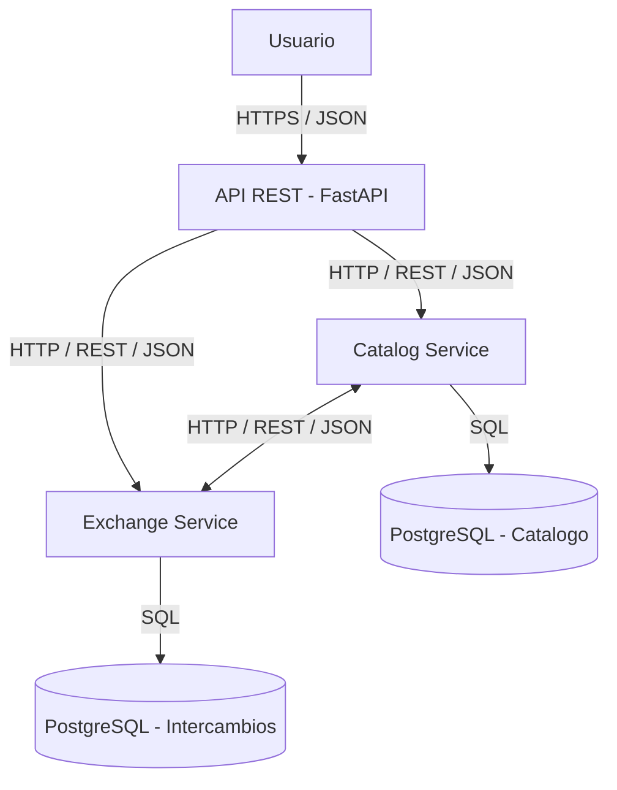

# SwapShelf

## 1. Descripción del proyecto

SwapShelf es una plataforma para intercambiar libros, juegos de mesa y videojuegos de segunda mano entre usuarios. El objetivo es facilitar la reutilización de productos, reducir el desperdicio y ayudar a los usuarios a encontrar artículos que necesitan.

La plataforma permite publicar artículos disponibles, crear listas de deseos, encontrar coincidencias entre usuarios y gestionar propuestas de intercambio.

## 2. Problema y oportunidad

Muchos libros y juegos que todavía están en buen estado dejan de utilizarse porque sus propietarios ya no los necesitan. Al mismo tiempo, otras personas buscan esos mismos productos, pero no siempre quieren comprarlos nuevos.

SwapShelf conecta a las personas que quieren ofrecer artículos con quienes desean obtenerlos, fomentando la reutilización y la economía circular.

## 3. Modelo de negocio

La plataforma podrá utilizar un modelo freemium:

- **Plan gratuito:** publicar artículos, buscar productos y proponer intercambios.
- **Créditos internos opcionales:** facilitar intercambios cuando dos usuarios no desean intercambiar artículos directamente.
- **Plan premium futuro:** funciones adicionales, como alertas personalizadas y mayor visibilidad de los anuncios.

Los créditos serán internos a la plataforma y no representarán dinero real. Los pagos reales quedan fuera del alcance de la primera versión.

## 4. Casos de uso principales

1. Un usuario publica un libro o juego que quiere intercambiar.
2. Otro usuario registra un artículo que desea conseguir.
3. El sistema identifica posibles coincidencias entre artículos ofrecidos y listas de deseos.
4. Un usuario propone un intercambio.
5. El otro usuario acepta o rechaza la propuesta.
6. Los participantes confirman la finalización del intercambio.
7. La plataforma actualiza el estado de los artículos y, cuando corresponda, los créditos internos.

## 5. Arquitectura de referencia

La primera versión utiliza una arquitectura basada en dos servicios independientes:

- **Catalog Service:** gestiona artículos, disponibilidad, listas de deseos y coincidencias.
- **Exchange Service:** gestiona propuestas, estados de los intercambios, confirmaciones y créditos internos.

Cada servicio expondrá una API REST. PostgreSQL almacenará los datos persistentes. Docker y Docker Compose facilitarán la ejecución local de los componentes.





La arquitectura podrá evolucionar hacia despliegues en Kubernetes, infraestructura como código, integración y entrega continuas y monitorización.

## 6. Tecnologías

- Python
- FastAPI
- PostgreSQL
- Docker y Docker Compose
- pytest
- GitHub Actions

## 7. API REST prevista

### Catalog Service

| Método | Endpoint | Descripción |
|---|---|---|
| POST | `/items` | Crear un artículo |
| GET | `/items` | Consultar artículos |
| GET | `/items/{id}` | Consultar un artículo |
| PATCH | `/items/{id}` | Actualizar un artículo |
| POST | `/wishlists` | Añadir un deseo a la lista |
| GET | `/matches` | Consultar coincidencias |

Ejemplo de solicitud para crear un artículo:

```json
{
  "title": "El principito",
  "category": "book",
  "condition": "good",
  "description": "Libro en buen estado"
}
```

### Exchange Service

| Método | Endpoint | Descripción |
|---|---|---|
| POST | `/exchanges` | Crear una propuesta |
| GET | `/exchanges/{id}` | Consultar una propuesta |
| POST | `/exchanges/{id}/accept` | Aceptar una propuesta |
| POST | `/exchanges/{id}/confirm` | Confirmar la finalización |
| POST | `/exchanges/{id}/cancel` | Cancelar una propuesta |
| GET | `/users/me/credits` | Consultar los créditos del usuario |

Las operaciones de intercambio seguirán reglas de negocio para impedir transiciones de estado inválidas y evitar movimientos duplicados de créditos.

## 8. Características del cloud computing según NIST SP 800-145

- **Autoservicio bajo demanda:** los usuarios gestionan sus anuncios y listas de deseos sin intervención manual del administrador. La infraestructura podrá aprovisionarse mediante automatización.
- **Acceso amplio a la red:** la plataforma se utilizará mediante una API HTTP y, en el futuro, una interfaz web accesible desde distintos dispositivos.
- **Agrupación de recursos:** los servicios podrán ejecutarse en infraestructura compartida del proveedor cloud y utilizar recursos comunes de computación y almacenamiento.
- **Elasticidad rápida:** el número de instancias de los servicios podrá ajustarse a la demanda cuando la infraestructura lo permita.
- **Servicio medido:** se recopilarán métricas de solicitudes, latencia, errores y uso de recursos para analizar el consumo y el rendimiento.

Estas características describen los objetivos de la solución cloud; su implementación se realizará progresivamente en los siguientes hitos.

## 9. Actores según NIST SP 500-292

- **Consumidor cloud:** el equipo del proyecto que utiliza los recursos cloud para ejecutar SwapShelf.
- **Proveedor cloud:** la empresa que proporciona computación, almacenamiento y otros servicios de infraestructura.
- **Broker cloud:** no se contempla inicialmente; podría incorporarse en el futuro para intermediar entre diferentes proveedores.
- **Auditor cloud:** una entidad independiente que podría evaluar la seguridad, el rendimiento y el cumplimiento.
- **Operador cloud:** el equipo responsable de desplegar, configurar, mantener y supervisar los servicios.

Los usuarios finales son consumidores de SwapShelf, pero no necesariamente consumidores directos de la infraestructura cloud.

## 10. Seguridad y fiabilidad

La solución tendrá en cuenta los siguientes aspectos:

- Validación de los datos recibidos por la API.
- Autenticación y autorización de usuarios.
- Almacenamiento seguro de contraseñas.
- Uso de variables de entorno para configurar secretos.
- Control de permisos y principio de mínimo privilegio.
- Pruebas automatizadas y registro de errores.
- Copias de seguridad de los datos persistentes.

Los créditos internos requerirán operaciones consistentes e idempotentes para evitar movimientos duplicados.

## 11. Organización del desarrollo

El trabajo se organizará mediante GitHub Issues, GitHub Projects y Pull Requests. Las funcionalidades se dividirán en historias de usuario con criterios de aceptación.

La integración continua ejecutará pruebas automatizadas. En los siguientes hitos se incorporarán contenedores, infraestructura como código, despliegue automatizado y observabilidad.

## 12. Impacto económico

SwapShelf puede prolongar la vida útil de libros y juegos, reducir la necesidad de comprar productos nuevos y facilitar el acceso a artículos de segunda mano.

Desde el punto de vista técnico, el uso de servicios contenerizados y recursos cloud escalables permitirá adaptar la capacidad a la demanda. Los costes dependerán del proveedor, del consumo y de los recursos desplegados.

## 13. Referencias

- NIST SP 800-145: The NIST Definition of Cloud Computing.
- NIST SP 500-292: NIST Cloud Computing Reference Architecture.
