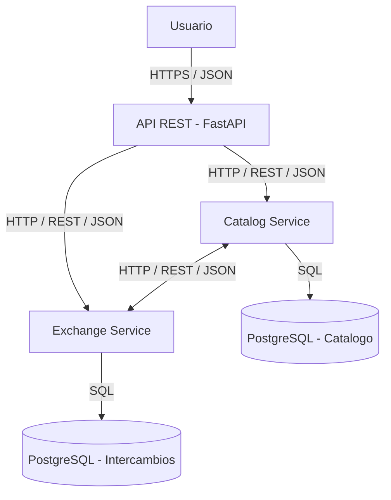

# SwapShelf

## 1. Descripción del proyecto

SwapShelf es una plataforma para intercambiar libros, juegos de mesa y videojuegos de segunda mano entre usuarios. El objetivo es facilitar la reutilización de productos, reducir el desperdicio y ayudar a los usuarios a encontrar artículos que necesitan.

La plataforma permite publicar artículos disponibles, crear listas de deseos, encontrar coincidencias entre usuarios y gestionar propuestas de intercambio.

## 2. Problema y oportunidad

Muchos libros y juegos que todavía están en buen estado dejan de utilizarse porque sus propietarios ya no los necesitan. Al mismo tiempo, otras personas buscan esos mismos productos, pero no siempre quieren comprarlos nuevos.

SwapShelf conecta a las personas que quieren ofrecer artículos con quienes desean obtenerlos, fomentando la reutilización y la economía circular.

## 3. Modelo de negocio

La plataforma podrá utilizar un modelo freemium:

- **Plan gratuito:** publicar artículos, buscar productos y proponer intercambios.
- **Créditos internos opcionales:** facilitar intercambios cuando dos usuarios no desean intercambiar artículos directamente.
- **Plan premium futuro:** funciones adicionales, como alertas personalizadas y mayor visibilidad de los anuncios.

Los créditos serán internos a la plataforma y no representarán dinero real. Los pagos reales quedan fuera del alcance de la primera versión.

## 4. Casos de uso principales

1. Un usuario publica un libro o juego que quiere intercambiar.
2. Otro usuario registra un artículo que desea conseguir.
3. El sistema identifica posibles coincidencias entre artículos ofrecidos y listas de deseos.
4. Un usuario propone un intercambio.
5. El otro usuario acepta o rechaza la propuesta.
6. Los participantes confirman la finalización del intercambio.
7. La plataforma actualiza el estado de los artículos y, cuando corresponda, los créditos internos.

## 5. Arquitectura de referencia

La primera versión utiliza una arquitectura basada en dos servicios independientes:

- **Catalog Service:** gestiona artículos, disponibilidad, listas de deseos y coincidencias.
- **Exchange Service:** gestiona propuestas, estados de los intercambios, confirmaciones y créditos internos.

Cada servicio expondrá una API REST. PostgreSQL almacenará los datos persistentes. Docker y Docker Compose facilitarán la ejecución local de los componentes.





La arquitectura podrá evolucionar hacia despliegues en Kubernetes, infraestructura como código, integración y entrega continuas y monitorización.

## 6. Tecnologías

- Python
- FastAPI
- PostgreSQL
- Docker y Docker Compose
- pytest
- GitHub Actions

## 7. API REST prevista

### Catalog Service

| Método | Endpoint | Descripción |
|---|---|---|
| POST | `/items` | Crear un artículo |
| GET | `/items` | Consultar artículos |
| GET | `/items/{id}` | Consultar un artículo |
| PATCH | `/items/{id}` | Actualizar un artículo |
| POST | `/wishlists` | Añadir un deseo a la lista |
| GET | `/matches` | Consultar coincidencias |

Ejemplo de solicitud para crear un artículo:

```json
{
  "title": "El principito",
  "category": "book",
  "condition": "good",
  "description": "Libro en buen estado"
}
```

### Exchange Service

| Método | Endpoint | Descripción |
|---|---|---|
| POST | `/exchanges` | Crear una propuesta |
| GET | `/exchanges/{id}` | Consultar una propuesta |
| POST | `/exchanges/{id}/accept` | Aceptar una propuesta |
| POST | `/exchanges/{id}/confirm` | Confirmar la finalización |
| POST | `/exchanges/{id}/cancel` | Cancelar una propuesta |
| GET | `/users/me/credits` | Consultar los créditos del usuario |

Las operaciones de intercambio seguirán reglas de negocio para impedir transiciones de estado inválidas y evitar movimientos duplicados de créditos.

### Ejemplo de solicitud para añadir un deseo

`POST /wishlists`

```json
{
  "item_title": "El principito",
  "category": "book"
}
```

### Ejemplo de consulta de coincidencias

`GET /matches`

Esta operación utiliza los criterios de la lista de deseos y los artículos disponibles del usuario para encontrar posibles coincidencias. No requiere un cuerpo JSON en la solicitud.

Ejemplo de respuesta:

```json
{
  "matches": [
    {
      "item_id": 12,
      "title": "El principito",
      "category": "book",
      "condition": "good"
    }
  ]
}
```

### Ejemplo de solicitud para crear una propuesta de intercambio

`POST /exchanges`

```json
{
  "offered_item_id": 12,
  "requested_item_id": 25,
  "message": "¿Te interesa intercambiar estos artículos?"
}
```

### Ejemplo de solicitud para confirmar un intercambio

`POST /exchanges/{id}/confirm`

```json
{
  "confirmation": true
}
```

### Consideraciones sobre la API

- Las solicitudes y respuestas que contienen datos utilizarán JSON y el tipo de contenido `application/json`.
- Los endpoints que modifican datos requerirán validación de campos y autorización del usuario correspondiente.
- Las respuestas utilizarán códigos HTTP adecuados, como `200 OK`, `201 Created`, `400 Bad Request`, `401 Unauthorized`, `404 Not Found` y `422 Unprocessable Entity`, según el resultado de la operación.
- Los campos mostrados son ejemplos del contrato previsto de la API y podrán ajustarse durante la implementación.


## 8. Características del cloud computing según NIST SP 800-145

- **Autoservicio bajo demanda:** los usuarios gestionan sus anuncios y listas de deseos sin intervención manual del administrador. La infraestructura podrá aprovisionarse mediante automatización.
- **Acceso amplio a la red:** la plataforma se utilizará mediante una API HTTP y, en el futuro, una interfaz web accesible desde distintos dispositivos.
- **Agrupación de recursos:** los servicios podrán ejecutarse en infraestructura compartida del proveedor cloud y utilizar recursos comunes de computación y almacenamiento.
- **Elasticidad rápida:** el número de instancias de los servicios podrá ajustarse a la demanda cuando la infraestructura lo permita.
- **Servicio medido:** se recopilarán métricas de solicitudes, latencia, errores y uso de recursos para analizar el consumo y el rendimiento.

Estas características describen los objetivos de la solución cloud; su implementación se realizará progresivamente en los siguientes hitos.

## 9. Actores según NIST SP 500-292

El modelo de referencia NIST SP 500-292 identifica los actores que participan en el ecosistema cloud. En SwapShelf, estos roles se interpretan de la siguiente manera:

- **Consumidor cloud:** el equipo de desarrollo utiliza los recursos cloud para desplegar y ejecutar SwapShelf. Los usuarios finales consumen las funcionalidades de la plataforma, pero no necesariamente utilizan directamente los servicios de infraestructura cloud. **Impacto económico:** los costes de infraestructura y servicios contratados deben ajustarse al presupuesto del proyecto. La automatización puede reducir el esfuerzo manual y los costes operativos.

- **Proveedor cloud:** la empresa que proporciona recursos de computación, almacenamiento, redes y, cuando corresponda, servicios gestionados. **Impacto económico:** ofrece un modelo de pago según los recursos contratados o consumidos, lo que puede reducir la inversión inicial en hardware. Sin embargo, un crecimiento no controlado del consumo puede aumentar los costes recurrentes.

- **Broker cloud (intermediario):** no se contempla en la versión inicial de SwapShelf. En el futuro, podría ayudar a comparar, combinar o gestionar servicios de diferentes proveedores. **Impacto económico:** podría facilitar la selección de servicios con una mejor relación entre precio y prestaciones, aunque añadiría posibles costes de intermediación y complejidad de gestión.

- **Auditor cloud:** una entidad independiente podría evaluar la seguridad, el rendimiento, la gestión de datos y el cumplimiento de los requisitos aplicables. **Impacto económico:** las auditorías pueden generar costes de evaluación y corrección, pero también ayudan a reducir riesgos, evitar incidentes y mejorar la confianza en la plataforma.

- **Operador cloud:** en el contexto operativo del proyecto, es el equipo responsable de desplegar, configurar, mantener y supervisar los servicios. Esta función operativa se distingue de los roles formales del modelo NIST. **Impacto económico:** la automatización de despliegues, pruebas y monitorización puede reducir el tiempo de mantenimiento y los errores humanos, aunque requiere una inversión inicial de desarrollo y configuración.

En conclusión, el modelo cloud permite a SwapShelf comenzar con una infraestructura ajustada a sus necesidades y aumentar su capacidad a medida que crezca el número de usuarios. La viabilidad económica dependerá de controlar el consumo de recursos, automatizar las operaciones y revisar periódicamente los costes.

**Nota sobre el modelo de referencia:** NIST SP 500-292 denomina *Cloud Carrier* al actor encargado de proporcionar conectividad y transporte de servicios cloud. En este proyecto se mantiene el término «Operador cloud» utilizado en el enunciado de la asignatura para describir la responsabilidad operativa del equipo.

## 10. Seguridad y fiabilidad

La solución tendrá en cuenta los siguientes aspectos:

- Validación de los datos recibidos por la API.
- Autenticación y autorización de usuarios.
- Almacenamiento seguro de contraseñas.
- Uso de variables de entorno para configurar secretos.
- Control de permisos y principio de mínimo privilegio.
- Pruebas automatizadas y registro de errores.
- Copias de seguridad de los datos persistentes.

Los créditos internos requerirán operaciones consistentes e idempotentes para evitar movimientos duplicados.

## 11. Organización del desarrollo

El trabajo se organizará mediante GitHub Issues, GitHub Projects y Pull Requests. Las funcionalidades se dividirán en historias de usuario con criterios de aceptación.

La integración continua ejecutará pruebas automatizadas. En los siguientes hitos se incorporarán contenedores, infraestructura como código, despliegue automatizado y observabilidad.

## 12. Impacto económico

SwapShelf puede prolongar la vida útil de libros y juegos, reducir la necesidad de comprar productos nuevos y facilitar el acceso a artículos de segunda mano.

Desde el punto de vista técnico, el uso de servicios contenerizados y recursos cloud escalables permitirá adaptar la capacidad a la demanda. Los costes dependerán del proveedor, del consumo y de los recursos desplegados.

## 13. Referencias

- NIST SP 800-145: The NIST Definition of Cloud Computing.
- NIST SP 500-292: NIST Cloud Computing Reference Architecture.

  ## 14. Estrategia de Git

La rama `main` contendrá la versión estable del proyecto. Las nuevas funcionalidades y correcciones se desarrollarán en ramas independientes con nombres descriptivos, por ejemplo:

- `feature/catalog-api`
- `feature/exchange-workflow`
- `fix/item-validation`
- `docs/readme-update`

Los cambios se integrarán en `main` mediante Pull Requests. Antes de integrar una modificación, se revisará el código y se comprobarán las pruebas correspondientes.

Se utilizarán commits semánticos para identificar el propósito de cada cambio:

- `feat:` nueva funcionalidad.
- `fix:` corrección de errores.
- `docs:` cambios en la documentación.
- `refactor:` reorganización del código sin cambiar su comportamiento.
- `test:` incorporación o modificación de pruebas.
- `ci:` cambios en la integración continua.

Las Issues de GitHub se utilizarán para registrar las historias de usuario y las tareas. Cada Pull Request deberá estar relacionado con la Issue correspondiente cuando sea aplicable.
